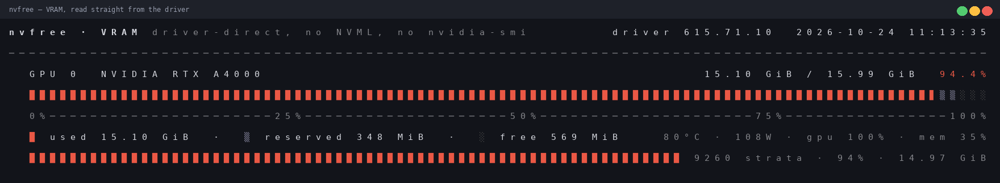

# nvfree

**How much VRAM is used — and how much you still have — as a bar graph in your
terminal. No NVML, no `nvidia-smi`, no CUDA. Just the kernel driver.**



`nvfree` asks the NVIDIA kernel module directly: `ioctl()`s on `/dev/nvidia*`,
the RUSD shared telemetry page (class `0x00de`) and the `FB_GET_INFO_V2`
control (`0x20801303`). The driver-ABI layer is
[`nvidia-smi-clone-RE`](https://github.com/zagg/nvidia-smi-clone-RE) — a
reverse-engineered, MIT-licensed reimplementation of what `nvidia-smi` does —
statically linked into a ~90 KB Rust CLI that only knows how to answer one
question: **how much of the frame buffer is mine to use?**

```console
$ ldd target/release/nvfree
        linux-vdso.so.1
        libgcc_s.so.1 => /lib/x86_64-linux-gnu/libgcc_s.so.1
        libc.so.6 => /lib/x86_64-linux-gnu/libc.so.6
        /lib64/ld-linux-x86-64.so.2
$ strace -f -e trace=openat ./target/release/nvfree -q >/dev/null
openat(AT_FDCWD, "/dev/nvidiactl", O_RDWR|O_CLOEXEC)                  = 3
openat(AT_FDCWD, "/dev/nvidia0",   O_RDWR|O_CLOEXEC)                  = 4
openat(AT_FDCWD, "/proc/driver/nvidia/gpus/0000:65:00.0/information", O_RDONLY) = 5
# zero hits for libnvidia-ml, zero hits for nvidia-smi
```

## What it looks like

```
nvfree · VRAM  driver-direct, no NVML, no nvidia-smi      driver 615.71.10   2026-10-24 11:09:42
────────────────────────────────────────────────────────────────────────────────────────────────
  GPU 0  NVIDIA RTX A4000                                         15.10 GiB / 15.99 GiB  94.4%
  ███████████████████████████████████████████████████████████████████████████████████████▊▒▒░░░
  0%──────────────────────25%────────────────────50%─────────────────────75%────────────────100%
  █ used 15.10 GiB  ·  ▒ reserved 348 MiB  ·  ░ free 569 MiB     84°C · 109W · gpu 100% · mem 36%
  ███████████████████████████████████████████████████████████████ 9260 strata · 94% · 14.97 GiB
```

Three segments, because VRAM is not two: what the driver reports as *free* is
what is left in the allocation heap, and the card also keeps a small pool that
`nvidia-smi` calls `memory.reserved`. `used + reserved + free == total`, always.

Live mode redraws in place, so the graph is a gauge, not a log:

```sh
nvfree -l 1 -p            # 1 s refresh, with the per-process breakdown
nvfree -l 5 --count 12    # twelve frames, then exit
```

## Install

Grab the prebuilt binary (static-ish: only `libc` and `libgcc_s`):

```sh
curl -LO https://github.com/zagg/nvfree/releases/download/v0.1.0/nvfree-0.1.0-x86_64-linux-gnu.tar.gz
tar xzf nvfree-0.1.0-x86_64-linux-gnu.tar.gz && sudo install -m755 nvfree /usr/local/bin/
nvfree --version
```

Needs the same access `nvidia-smi` needs — i.e. root, or a user in the `video`
group with `/dev/nvidiactl` writable. Works inside a container that only has
`/dev/nvidia*` mounted; nothing else from the NVIDIA stack has to be in the image.

## Build

```sh
make release          # cargo path; the driver library is fetched by build.rs
make vendor && make release   # if you have no checkout of the library
NVSMI_RE=~/nvidia-smi-clone-RE make release   # explicit library location
make rustc            # no cargo at all: plain gcc + rustc, one archive
```

Requirements: `gcc`, `rustc`/`cargo`, `make`. **No crates.** The C library is
compiled into `libnvf.a` by `build.rs` and statically linked, which is why the
result has no NVIDIA dependency to fall back on.

| File | What it is |
|---|---|
| `src/main.rs` | argument handling, snapshot loop, in-place ANSI redraw |
| `src/gpu.rs` | the narrow view of the driver data model (VRAM + a few fields) |
| `src/bar.rs` | the bar graph: eighth-block precision, colour ramp, ASCII fallback |
| `src/render.rs` | layout: per-GPU block, compact line, per-process rows, JSON |
| `csrc/nvfree_shim.c` | flat accessors so Rust never has to mirror `nv_ctx_t` |
| `build.rs` | finds the driver library, compiles it, links `libnvf.a` |

## Usage

```
nvfree [OPTION]...

  -l, --loop[=SEC]    keep refreshing (default: 1 s)
      --count=N       number of frames with --loop (0 = forever)
  -i, --gpu=ID        pick a GPU: index, name substring or GPU-<uuid>; repeatable
  -1, --compact       one line per GPU - fits in logs, prompts and scripts
  -p, --procs[=N]     show which processes hold the VRAM (N = 5 by default)
  -w, --width=N       graph width (default: terminal width)
      --no-ticks      drop the 0/25/50/75/100 % scale
  -u, --units=U       auto (default), MiB or GiB
  -a, --ascii         ASCII blocks (# + -) instead of █ ▒ ░
      --no-color      plain text (NO_COLOR, TERM=dumb and pipes do the same)
  -q, --quiet         no header, no legend
      --json          machine-readable snapshot (NDJSON when used with --loop)
      --free-min=S    exit code 3 if any GPU has less than S free
  -h, --help          this help
  -V, --version       version, plus where the data comes from
```

### One-liners

```sh
nvfree -1qa                       #  0  RTX A4000  #####...-  15.1/16.0G  94.4%
nvfree --json | jq .vram_mib.free #  569
nvfree -1 -q --no-color | awk '{print $1, $NF}'
nvidia-smi --query-gpu=memory.free --format=csv,noheader,nounits   # same number
```

### As a gate for a job scheduler

`--free-min` exists so that a launcher can ask "is there room?" without
parsing a graph:

```sh
nvfree -i 0 --free-min=14G || exit 1     # 0 = enough room on GPU 0
echo $?                                  # 3 = not enough
```

Exit codes: `0` fine, `1` driver not reachable, `2` bad usage, `3` below
`--free-min`, `4` no GPU matched the filter.

## Do the numbers match the vendor tool?

`make check` answers that with the reference tool on the same box, same second:

```
comparing against nvidia-smi (MiB, NVML rounding):
  GPU 0  nvfree=16376/15459/569/349  nvidia-smi=16376/15459/569/349  OK
internal consistency (used + reserved + free == total):
  GPU 0  15829952 + 356480 + 582592 = 16769024 vs total 16769024  OK
```

The library's reverse-engineered formulas are what make that agree: `total` is
FB tag `TOTAL_RAM_SIZE` (8), `used` is `HEAP_SIZE (9) - HEAP_FREE (22)` —
NVML's own formula, *not* `total - free` — and the KiB→MiB conversion rounds
**up**, which is why the last MiB lines up with `nvidia-smi` instead of
drifting by one. Details in
[docs/REVERSE_ENGINEERING.md](https://github.com/zagg/nvidia-smi-clone-RE/blob/main/docs/REVERSE_ENGINEERING.md)
of the library.

## Safety

Read-only by construction: the only RM commands issued are `GET`/`QUERY`
controls plus the version handshake and `ATTACH_IDS` needed to open a client.
No `PERF_BOOST`, no power-limit writes, no persistence changes, no resets. One
poll (`REQUEST_DATA_POLL`, `0x00de` seqlock page) per frame, so a 1 s refresh
costs a couple of ioctls, not a process spawn and a dozen control round-trips.

## Why bother, when `nvidia-smi` exists

* containers: the monitoring image only needs `/dev/nvidia*`, not the vendor CLI
* cost: `nvidia-smi` forks and does a full control round-trip per scrape; here a
  sample is one ioctl plus reads from an already-mapped page
* parsing: `--json`, or `-1` for a line, instead of scraping a box-drawn table
* it is genuinely the only way on some hosts: no `hwmon`, no `sensors`, nothing
  in sysfs — those numbers exist only inside `libnvidia-ml.so` and the RUSD page

## Known limits

* validated on one card (RTX A4000 / GA104) and driver `615.71.10`, open kernel
  module; the RUSD layout (`RUSD_SIZE == 3184`) is the first thing to re-check
  on another driver branch — the library documents how
* MIG instances and `memory.reserved` on datacenter SKUs with heap accounting
  differences are not modelled here (the library documents the same gap)
* the process breakdown uses the same source as `nvidia-smi`'s process table, so
  anything invisible there (some graphics clients) is invisible here too

## Provenance and license

* the driver ABI layer — ioctls, RM classes, controls, RUSD offsets, unit
  conversions — is [`nvidia-smi-clone-RE`](https://github.com/zagg/nvidia-smi-clone-RE),
  a free, independent, reverse-engineered reimplementation of that interface;
  the method, the traps and the decode tables are written up in its `docs/`
* this program is MIT (see [LICENSE](LICENSE) and [NOTICE](NOTICE))
* independent implementation: no NVIDIA source code, binary, firmware or dump is
  included or redistributed

"NVIDIA", "nvidia-smi", "NVML" and "CUDA" are trademarks of NVIDIA Corporation.
This project is not affiliated with, sponsored or endorsed by NVIDIA.
